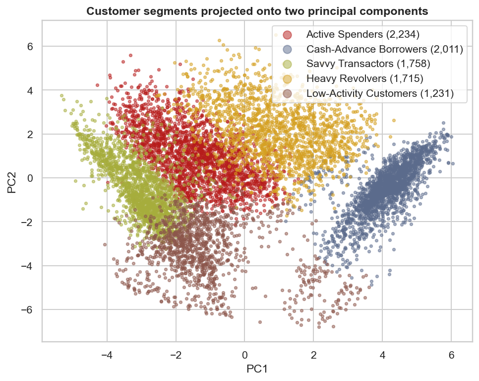
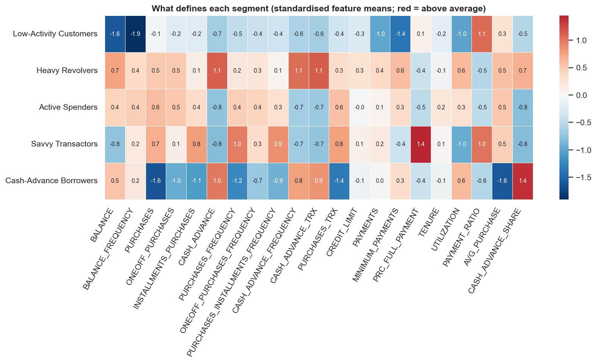
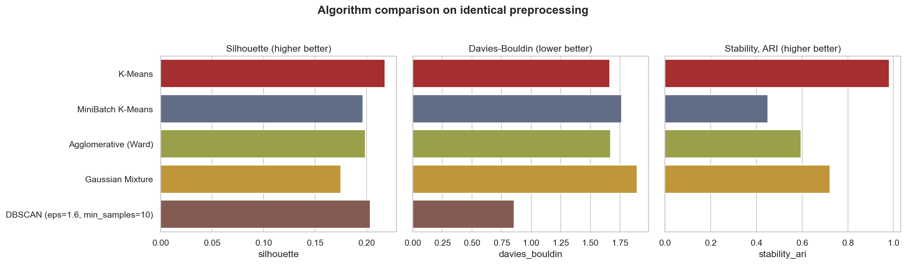
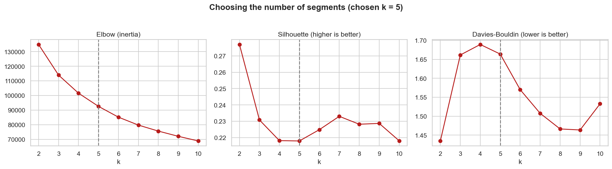

# Customer Segmentation with Unsupervised Learning

Segmenting ~9,000 credit-card customers into five actionable personas, with a reproducible pipeline, an honest comparison of five clustering algorithms, and an interactive Streamlit app.



## Why this project

Marketing and risk teams need to know *who* their customers are, not just that clusters exist. Most clustering tutorials stop at a silhouette score. This project goes further:

- fixes the preprocessing problems that make credit-card data hard to cluster (heavy right-skew, zero-inflated amounts),
- compares algorithms on **several metrics plus stability**, instead of crowning whichever has the highest silhouette,
- turns the chosen clusters into **named personas with suggested business actions**,
- ships as an installable package, a test suite and a small web app.

## Results

**Dataset:** 8,950 credit-card holders over 6 months, 17 behavioural variables (balance, purchases, cash advances, payment behaviour, credit limit, tenure). Source: the public *Credit Card Dataset for Clustering* on Kaggle.

### Five personas

| Persona | Share | What they do | Suggested action |
|---|---|---|---|
| **Active Spenders** | 25% | Frequent buyers, large one-off purchases, moderate utilisation | Instalment plans, spend rewards, limit increases |
| **Cash-Advance Borrowers** | 22% | Almost no purchases; carry a balance funded by cash advances | Low-rate personal loans, balance transfers, risk monitoring |
| **Savvy Transactors** | 20% | Buy constantly, pay in full, ~3% utilisation | Cashback / premium cards (interchange revenue) |
| **Heavy Revolvers** | 19% | High balance and utilisation, purchases *and* cash advances | Credit-line reviews, instalment conversion |
| **Low-Activity Customers** | 14% | Small limits, low balances, rarely use the card | Re-engagement and churn-prevention campaigns |



### Algorithm comparison (same preprocessing, k = 5)

| Model | Silhouette ↑ | Davies-Bouldin ↓ | Stability (ARI) ↑ |
|---|---|---|---|
| **K-Means** | **0.218** | 1.66 | **0.98** |
| MiniBatch K-Means | 0.196 | 1.76 | 0.45 |
| Agglomerative (Ward) | 0.199 | 1.67 | 0.60 |
| Gaussian Mixture | 0.175 | 1.90 | 0.72 |
| DBSCAN (eps 1.6, min_samples 10) | 0.204* | 0.86* | n/a |

\*DBSCAN labels 19% of customers as noise and the scores are computed without them, so they are not directly comparable. Stability is the mean Adjusted Rand Index between the full-data clustering and ten 80% subsamples.



**K-Means wins on the criteria that matter operationally:** best silhouette, and by far the most reproducible segments (ARI 0.98 against 0.45–0.72 for the others), so the same customer lands in the same segment from run to run.

### What I learned (and an honest caveat)

- **Silhouette scores are low (~0.2) for every method.** Customer behaviour is a continuum, not a set of islands. The segments are useful because they are interpretable and stable, not because they are geometrically well separated. Internal metrics are almost flat from k = 3 to 10, so I chose **k = 5 for interpretability and stability**, and say so rather than pretending a metric picked it.
- **A log transform matters.** Features such as `PURCHASES` and `MINIMUM_PAYMENTS` have skewness of 8-14; without it a handful of whales dominate distances.
- **Beware a high silhouette from DBSCAN.** A DBSCAN run that returns one big cluster plus noise can score a very high silhouette while producing no segmentation at all. The tuner here rejects such solutions (≥ 2 clusters, ≤ 25% noise, no cluster > 90% of the rest).
- **Missing `MINIMUM_PAYMENTS` means "no minimum payment due"**, so it is filled with 0 rather than the median.



## Quick start

```bash
git clone https://github.com/omsawant-ds/Customer-Segmentation-Using-Clustering.git
cd Customer-Segmentation-Using-Clustering
pip install -r requirements.txt

# regenerate every table and figure in reports/
PYTHONPATH=src python -m segmentation.pipeline        # PowerShell: $env:PYTHONPATH="src"; python -m segmentation.pipeline

# launch the interactive app
streamlit run app/streamlit_app.py

# run the tests
python -m pytest
```

The app has three tabs: a segment overview, a form that scores a single customer, and a CSV upload that scores a whole portfolio and lets you download the result.

## Project structure

```
├── data/Customer_Data.csv          raw dataset
├── src/segmentation/
│   ├── data.py                     loading + cleaning
│   ├── preprocess.py               feature engineering, log transform, scaling
│   ├── models.py                   five algorithms behind one interface, DBSCAN tuner
│   ├── evaluate.py                 silhouette / DB / CH, k-sweep, subsample stability
│   ├── profile.py                  cluster -> persona mapping and business actions
│   ├── segmenter.py                fit / predict API used by the app
│   ├── viz.py                      figures
│   └── pipeline.py                 end-to-end CLI
├── app/streamlit_app.py            interactive app
├── tests/                          pytest suite (12 tests)
├── reports/                        generated metrics, segment profiles, per-customer assignments, figures
└── notebooks/                      01_eda.ipynb, 02_segmentation.ipynb
```

## Feature engineering

Four ratios were added to the 17 raw features: `UTILIZATION` (balance / credit limit), `PAYMENT_RATIO` (payments / balance), `AVG_PURCHASE` (purchases / transactions) and `CASH_ADVANCE_SHARE` (cash advance as a share of cash advance + purchases). Skewed features (> 1.0) are `log1p`-transformed, then everything is standardised. Preprocessing is a scikit-learn pipeline, so new customers are transformed exactly like the training data.

## Notebooks

Two executed notebooks walk through the analysis using the package:

- [`notebooks/01_eda.ipynb`](notebooks/01_eda.ipynb): data quality, skew, correlations, engineered features.
- [`notebooks/02_segmentation.ipynb`](notebooks/02_segmentation.ipynb): choosing k, comparing five algorithms, personas, scoring new customers.

## Possible next steps

- Add a supervised check: predict segment from a subset of features to see which behaviours drive membership (SHAP).
- Track segment migration over time with monthly snapshots.
- Try density-aware methods on a UMAP embedding.

## License

MIT, see [LICENSE](LICENSE).

## Author

Om Sawant
